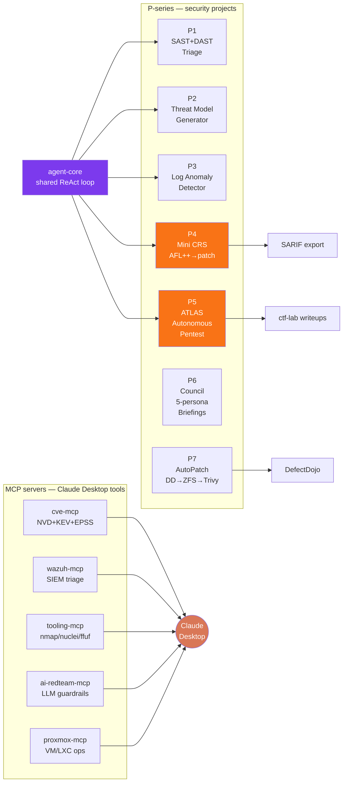

<div align="center">

<!-- Typing header -->
[](https://git.io/typing-svg)

<br/>

[](https://www.greenbladesec.com)
[](https://dev.to/greenbladesec)
[](https://linkedin.com/in/gpsingh-sec)
[](https://github.com/PyHackSecGP)

</div>

---

## 👤 About

```python
profile = {
    "name":         "GP Singh",
    "location":     "Vancouver, BC 🇨🇦",
    "current_role": "Cybersecurity Analyst",
    "target_role":  "Senior AI Red Team Engineer — $200k CAD remote by Jul 2027",
    "thesis":       "LLMs collapse the cost of agentic security tooling — build the stack now",
    "focus": [
        "Agentic security pipelines (ReAct + tool use)",
        "AI red-team / LLM safety eval",
        "SAST/DAST triage + CVE prioritisation",
        "Autonomous HTB / CTF pipelines",
        "Mini-CRS fuzz-to-patch loops (DARPA AIxCC inspired)",
    ],
    "shipped_2026": {
        "projects":    "P1 → P7 end-to-end security tools",
        "mcp_servers": "5 Claude-driven MCPs (cve, wazuh, tooling, ai-redteam, proxmox)",
        "shared_core": "agent-core — ReAct loop used by all P-series projects",
        "tests":       "550+ passing across the portfolio",
    },
    "stack":        ["Python 3.11+", "Claude Haiku + Sonnet", "Ollama", "MCP", "SARIF", "MITRE ATT&CK"],
    "homelab":      "Proxmox + Tailscale mesh + Forgejo mirror + Wazuh + Greenbone + Falco",
    "philosophy":   "Ship over plan. One commit beats a hundred TODOs.",
}
```

---

## 🎯 Portfolio Architecture



---

## 🚀 Featured Projects — The P-Series

| Project | Role | Tests | Stack |
|---|---|---|---|
| [**P5 — ATLAS**](https://github.com/PyHackSecGP/p5-atlas) | 9-agent autonomous HTB pentester with dynamic routing, human checkpoints, tiered Haiku/Sonnet, MITRE ATT&CK writeup, portfolio metrics | **194** | Agentic AI · nmap · ffuf · nuclei · hydra |
| [**P4 — Mini CRS**](https://github.com/PyHackSecGP/p4-mini-crs) | DARPA-AIxCC-inspired: fuzz → ASan triage → LLM root cause → auto-patch → verify. 1-shot CLI + auto daemon. | **121** | AFL++ · Claude Haiku 4.5 · SARIF |
| [**P1 — SAST/DAST Triage**](https://github.com/PyHackSecGP/p1-sast-dast-triage) | Dedupes Semgrep/Bandit/ZAP/Trivy/Nuclei, CWE-based risk scoring, LLM FP filter, SARIF export | **117** | Python · agent-core · Ollama |
| [**P7 — AutoPatch**](https://github.com/PyHackSecGP/p7-autopatch) | Autonomous CVE remediation: DefectDojo → ZFS snapshot → apt/apk patch → Trivy verify → auto-rollback. Zero cloud deps. | **40** | DefectDojo · ZFS · Trivy · systemd |
| [**P3 — Log Anomaly Detector**](https://github.com/PyHackSecGP/p3-log-anomaly-detector) | Rule + z-score detection on auth/journalctl/nginx logs. MITRE ATT&CK heatmap, agentic Ollama investigation, dry-run remediation. Zero third-party deps. | **64** | Python stdlib · Ollama · SARIF |
| [**P2 — Threat Model Generator**](https://github.com/PyHackSecGP/p2-threat-model-generator) | STRIDE from YAML/OpenAPI/Dockerfile/Compose/K8s/Terraform. Compliance flagging (GDPR, PCI-DSS, SOC2, HIPAA). HTML + SARIF reports. | **54** | STRIDE · python-hcl2 · Ollama |

<details>
<summary><b>+ Supporting portfolio (agent-core, CTF lab, MCPs, labs)</b></summary>

| Repo | What it does |
|---|---|
| [agent-core](https://github.com/PyHackSecGP/agent-core) | Shared ReAct tool-calling loop + `@tool` decorator + `ExecutionPolicy` + Claude/Ollama providers. One abstraction, 5 consumers (P1–P5). |
| [cve-mcp](https://github.com/PyHackSecGP/cve-mcp) | MCP unifying NVD + CISA KEV + FIRST EPSS for CVE triage. Composite risk scoring. |
| [wazuh-mcp](https://github.com/PyHackSecGP/wazuh-mcp) | MCP for Wazuh SIEM — NL triage of alerts, agent status, rule lookup. |
| [tooling-mcp](https://github.com/PyHackSecGP/tooling-mcp) | MCP wrappers for nmap / nuclei / gobuster / ffuf / httpx / semgrep / trivy. |
| [ai-redteam-mcp](https://github.com/PyHackSecGP/ai-redteam-mcp) | MCP for LLM guardrail testing — prompt-injection corpus, mutations, bypass tracking. |
| [proxmox-mcp](https://github.com/PyHackSecGP/proxmox-mcp) | MCP for Proxmox VE — list/start/stop VMs + LXCs from Claude Desktop. |
| [ctf-lab](https://github.com/PyHackSecGP/ctf-lab) | Public CTF writeups. ATLAS auto-commits on every successful root. |
| [memory-safety-lab](https://github.com/PyHackSecGP/memory-safety-lab) | C exploitation exercises (buffer overflow, UAF, heap). Intuition training for P4. |
| [offsec-saturdays](https://github.com/PyHackSecGP/offsec-saturdays) | Weekly offensive-security study journal. |

</details>

---

## 📊 GitHub Stats

<div align="center">


<br/>


</div>

---

## 🐍 Contribution Snake

<div align="center">


</div>

---

## ✍️ Latest Writeups

<!-- BLOG-POST-LIST:START -->- [I gave my STRIDE threat modelling tool an agentic interview mode](https://dev.to/greenbladesec/i-gave-my-stride-threat-modelling-tool-an-agentic-interview-mode-1dao) &nbsp; <sub>Sep 2, 2026</sub>- [I Built an AI Security Agent That Found Vulnerabilities in Its Own Code &lpar;And Why That&#39;s the Point&rpar;](https://dev.to/greenbladesec/i-built-an-ai-security-agent-that-found-vulnerabilities-in-its-own-code-and-why-thats-the-point-519h) &nbsp; <sub>Sep 1, 2026</sub>- [Building an AI-Powered Auth Log Anomaly Detector with MITRE ATT&amp;CK](https://dev.to/greenbladesec/building-an-ai-powered-auth-log-anomaly-detector-with-mitre-attck-4ai2) &nbsp; <sub>Aug 31, 2026</sub>- [I Built a SAST/DAST Triage Pipeline Because Scanner Noise Was Killing My Signal](https://dev.to/greenbladesec/i-built-a-sastdast-triage-pipeline-because-scanner-noise-was-killing-my-signal-4126) &nbsp; <sub>Aug 31, 2026</sub>- [Homelab Day: Nextcloud + Traefik + HSTS Headers That Actually Work](https://dev.to/greenbladesec/homelab-day-nextcloud-traefik-hsts-headers-that-actually-work-4cb3) &nbsp; <sub>Aug 11, 2026</sub><!-- BLOG-POST-LIST:END -->

> ⚡ Auto-updated from [dev.to/greenbladesec](https://dev.to/greenbladesec) by a GitHub Action.

---

## 🛠️ Tech Stack

<div align="center">

**Languages & Runtime**  


**AI x Security**  


**Offensive**  


**Defensive**  


**Infra & Ops**  


</div>

---

## 🏴‍☠️ HTB Portfolio Metrics

<div align="center">


</div>

> P5 ATLAS appends every attempt to `~/.atlas/portfolio.json` — solve rate, duration, MITRE technique histogram, agents involved. Run `python -m metrics` locally for the dashboard. Public writeups land in [ctf-lab](https://github.com/PyHackSecGP/ctf-lab).

---

## 🔭 What I'm Shipping Now

- **P6 Council** — 5-persona AI briefing (voice + text) at 07:00 + 19:00 Pacific — ongoing accountability loop
- **Nudger** — 5x/day Telegram accountability bot with loss-framed messaging, SQLite + nightly CouchDB vault rollup
- **MCP toolkit expansion** — hardening the 5 shipped MCPs (cve, wazuh, tooling, ai-redteam, proxmox) + planning a 6th for SIEM playbook execution
- **ATLAS portfolio metrics** — just added flag-capture tracking + atlas-stats CLI
- **AIxCC-track learning** — reading the full DARPA AIxCC winners' postmortems, folding ideas into P4 Mini-CRS Phase 6

---

## 🧠 How I Work

```
┌─────────────────────────────────────────────────────────────────────┐
│  1. Ship something every day — one function > a hundred TODOs       │
│  2. 3-audience READMEs (novice → interviewer → technical) on every  │
│     portfolio repo so one click is enough to understand the project │
│  3. Tests pass or it doesn't land — 550+ pytests across the P-series│
│  4. Local-first — Ollama fallback on every LLM path. No cloud lock  │
│  5. Zero cloud deps where stdlib covers it (P3 ships with just that)│
│  6. SARIF 2.1.0 + MITRE ATT&CK on everything defender-facing        │
└─────────────────────────────────────────────────────────────────────┘
```

---

## 🏠 Homelab Stack

```
Proxmox 8   ─┬─ PVE host (Tailscale mesh)
             ├─ brain LXC          — CouchDB + Obsidian LiveSync + RSS
             ├─ claw-core (base)   — P4/P6/nudger/stock-tracker systemd
             ├─ mediaserver LXC    — Jellyfin + Seerr + Immich
             ├─ scanner / greenbone — vuln pipeline → DefectDojo
             ├─ pihole / adguard   — DNS + ad filter
             └─ forgejo (Docker)   — self-hosted git mirror of everything
```

ISP router handles LAN perimeter. OPNsense decommissioned 2026-10-28 to simplify the stack.

---

## 🌐 Reach me

<div align="center">

[](https://www.greenbladesec.com)
[](https://dev.to/greenbladesec)
[](https://linkedin.com/in/gpsingh-sec)

</div>

<div align="center">

---

<em>"Ship something every day. Consistency beats perfection."</em>

<sub>README driven by GitHub Actions: snake animation (Platane/snk), dev.to post feed (gautamkrishnar/blog-post-workflow). Last authored 2026-10-29.</sub>

</div>
